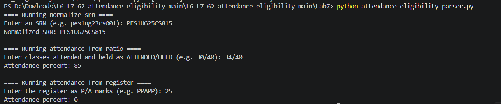
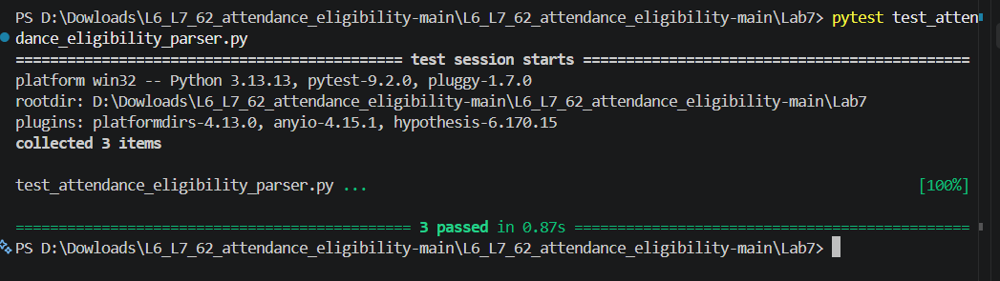
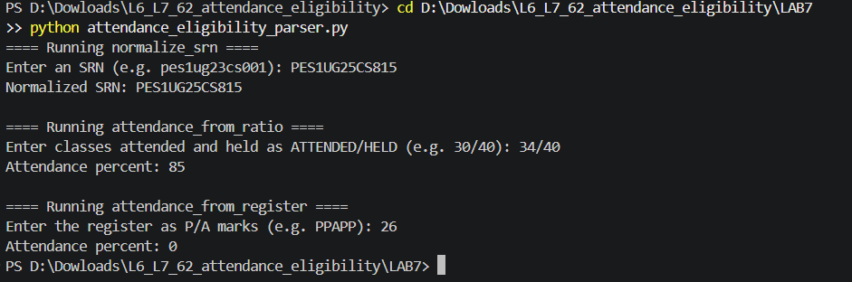

# Lab 7 – Distributed Data Processing 

**Name:** Harshith Kumar S  
**SRN:** PES1UG25CS815  

---

## 1. Objective
To implement and execute the Lab 7 Python scripts and verify the output across all required test cases and execution stages.

## 2. Files Included
* `script1.py` – *(Replace with your actual first `.py` filename and a 1-line description)*
* `script2.py` – *(Replace with your actual second `.py` filename and a 1-line description)*
* `SS1.png` – `SS4.png` – Execution and output screenshots

---

## 3. Execution & Output Screenshots

### Screenshot 1: Setup / Initial Execution

### Screenshot 2: Processing / Intermediate Output

### Screenshot 3: Verification / Logs

### Screenshot 4: Final Output

---

## 4. Observation & Conclusion
Both Python scripts executed without errors, and the generated outputs matched the expected results as shown in the screenshots above.
